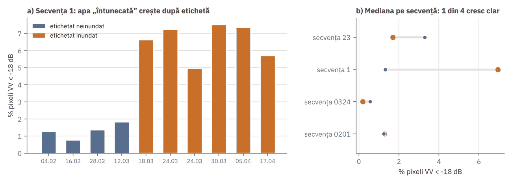

# H8 HazardTwin: Galați, Dunăre

Mini digital twin pentru IC3 (SIVA, an II): **detecția inundației din serii multi-temporale Sentinel-1**
pentru municipiul Galați și lunca Dunării (confluența cu Siretul și Prutul).
Clientul este Primăria Galați (CLSU), iar decizia este alerta de inundație.

| Strat | Stare |
|---|---|
| CP0 Concept | gata |
| **CP1 Observații** | pipeline de ingestie SEN12FLOOD (acest repo), data card, tabel SOA |
| CP2 Reprezentare | urmează: seria S1 pe Galați din GEE, baseline Otsu |

## Instalare

```bash
python -m venv .venv && .venv\Scripts\activate      # Windows (Linux/macOS: source .venv/bin/activate)
pip install -e .[dev]
```

## Date

SEN12FLOOD nu se pune în repo (12,2 GB). Se descarcă de pe
[IEEE DataPort](https://ieee-dataport.org/open-access/sen12-flood) (doi:10.21227/w6xz-s898), cu cont IEEE gratuit,
și se dezarhivează, de exemplu în `D:\data\SEN12FLOOD`. Folderul (după dezarhivare: `SEN12FLOOD\SEN12FLOOD`) trebuie să conțină `S1list.json`, `S2list.json` și folderele secvențelor:
`0001 … 0336` (train oficial) și `0 … 67` (test oficial).

## Rulare

```bash
python -m h8twin.cli ingest --root D:\data\SEN12FLOOD --out outputs   # index + split + statistici pentru data card
python -m h8twin.cli figure --out outputs --seq 1                     # figura CP1: fracția de apă întunecată vs. etichetă
pytest -q                                                             # teste pe un set sintetic cu același format
```

Ce produce `ingest`:

- `outputs/index.csv`: un rând pe imagine (senzor, secvență, dată, FLOODING, FULL-DATA-COVERAGE, orbită, fișiere găsite);
- `outputs/split.csv`: împărțirea train/test pe secvențe, grupate pe regiuni de 2°×2°, ca să nu existe scurgere spațială;
- `outputs/stats.json`: cifrele din data card (număr de imagini, revizitare, % inundat, goluri, scurgerea split-ului oficial).

Rezultatul CP1 (vezi [docs/datacard_H8.md](docs/datacard_H8.md)): 335 de secvențe, 3957 de imagini S1 și 3131 S2. Split-ul oficial
are scurgere spațială (67 din 68 de secvențe de test sunt la mai puțin de 10 km de train), așa că folosesc un split spațial
pe regiuni de 2°: 258 de secvențe în train și 77 în test.



## Structură

```
src/h8twin/sen12flood.py   parsare JSON, căutare fișiere, citire S1 în dB, tensor (T, 2, H, W), split spațial
src/h8twin/stats.py        statistici pentru data card
src/h8twin/figures.py      figura CP1 (fracția de pixeli VV < -18 dB vs. etichetă)
src/h8twin/cli.py          comenzile ingest / figure
gee/galati_s1_timeseries.js  export GEE al seriei S1 pe Galați (pentru CP2; încă nerulat)
docs/datacard_H8.md        data card
docs/soa_H8.md             tabelul SOA (10 articole)
docs/stats_cp1.json        rezultatul ingest pe SEN12FLOOD (metadate complete, pixeli pe 4 secvențe)
tests/                     test end-to-end pe date sintetice
```

## Licențe

Codul: MIT. SEN12FLOOD conține date Copernicus Sentinel modificate (2018–2019), sub Termenii și condițiile Sentinel.
