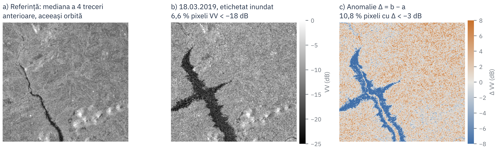
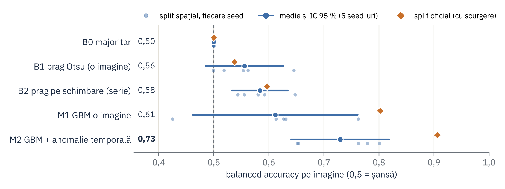

# H8 HazardTwin: Galați, Dunăre

Mini digital twin pentru IC3 (SIVA, an II): **detecția inundației din serii multi-temporale Sentinel-1**
pentru municipiul Galați și lunca Dunării (confluența cu Siretul și Prutul).
Clientul este Primăria Galați (CLSU), iar decizia este alerta de inundație.

| Strat | Stare |
|---|---|
| CP0 Concept | gata |
| CP1 Observații | pipeline de ingestie SEN12FLOOD, data card, tabel SOA |
| CP2 Reprezentare | anomalia față de imaginile anterioare vs. dB brut; baseline Otsu; split spațial (`features.py`, `learn.py`) |
| **CP3 Învățare** | metodă vs. baseline-uri pe split spațial, 5 seed-uri, IC 95 % (`learn.py`, `docs/results_v1_H8.csv`) |

## Instalare

```bash
python -m venv .venv && .venv\Scripts\activate      # Windows (Linux/macOS: source .venv/bin/activate)
pip install -e .[dev]
```

## Date

SEN12FLOOD nu se pune în repo (12,2 GB). Se descarcă de pe
[IEEE DataPort](https://ieee-dataport.org/open-access/sen12-flood) (doi:10.21227/w6xz-s898), cu cont IEEE gratuit,
și se dezarhivează, de exemplu în `D:\data\SEN12FLOOD`. Folderul (după dezarhivare: `SEN12FLOOD\SEN12FLOOD`) trebuie să conțină `S1list.json`, `S2list.json` și folderele secvențelor:
`0001 … 0336` (train oficial) și `0 … 67` (test oficial).

## Rulare

```bash
python -m h8twin.cli ingest --root D:\data\SEN12FLOOD --out outputs   # index + split + statistici pentru data card
python -m h8twin.cli figure --out outputs --seq 1                     # figura CP1: fracția de apă întunecată vs. etichetă
python -m h8twin.cli learn --root D:\data\SEN12FLOOD --out outputs   # CP3: trăsături + 5 metode x 5 seed-uri -> results_v1_H8.csv
pytest -q                                                             # teste pe un set sintetic cu același format
```

Tot proiectul rulează și în Kaggle, fără instalare: `notebooks/h8_cp3_kaggle.ipynb` (dataset Kaggle
*SEN12FLOOD: Flood Detection Dataset*, CPU, circa 15 minute). Notebook-ul scrie modulele din `src/h8twin` cu `%%writefile`.

Ce produce `ingest`:

- `outputs/index.csv`: un rând pe imagine (senzor, secvență, dată, FLOODING, FULL-DATA-COVERAGE, orbită, fișiere găsite);
- `outputs/split.csv`: împărțirea train/test pe secvențe, grupate pe regiuni de 2°×2°, ca să nu existe scurgere spațială;
- `outputs/stats.json`: cifrele din data card (număr de imagini, revizitare, % inundat, goluri, scurgerea split-ului oficial).

Rezultatul CP1 (vezi [docs/datacard_H8.md](docs/datacard_H8.md)): 335 de secvențe, 3957 de imagini S1 și 3131 S2. Split-ul oficial
are scurgere spațială (67 din 68 de secvențe de test sunt la mai puțin de 10 km de train), așa că folosesc un split spațial
pe regiuni de 2°: 258 de secvențe în train și 77 în test.


## CP2: reprezentare, baseline, protocol

- **Reprezentarea aleasă:** anomalia față de trecut, adică VV/VH în dB minus mediana pe pixel a cel mult 6 imagini
  anterioare de pe aceeași orbită (13 trăsături). **Alternativa:** dB brut dintr-o singură imagine (29 de trăsături).
- **Baseline:** prag Otsu global pe histograma VV din train + prag pe aria întunecată: 0,56 [0,49; 0,63] balanced accuracy;
  aceeași regulă pe anomalie (Δ < −3 dB): 0,58 [0,53; 0,63]. Pragul Otsu iese −7 … −9,25 dB, nu −18 dB.
- **Protocol:** split spațial pe celule de 2° × 2° (21 de grupuri, serii întregi), 20 % din serii în test, 5 seed-uri,
  IC 95 % (t) și diferențe pereche. Split-ul oficial are scurgere, iar setul are un singur sezon, deci nu se poate temporal/LOYO.



Figura se regenerează cu `python docs/make_fig_cp2.py <root SEN12FLOOD> docs/fig_cp2_representation.png 1 2019-03-18`.

## CP3: rezultate v1

Sarcina: eticheta FLOODING pe imagine, din Sentinel-1 VV/VH (3891 de imagini cu fișiere, 335 de serii). Split spațial pe
celule de 2° × 2° (20 % din serii în test), repetat pe 5 seed-uri; IC 95 % cu t peste seed-uri.

| Metodă | Bal. acc. [IC 95 %] | F1 [IC 95 %] | AUC [IC 95 %] | Split oficial* |
|---|---|---|---|---|
| B0 majoritar | 0,50 [0,50; 0,50] | 0,00 | 0,50 | 0,50 |
| B1 prag Otsu (o imagine) | 0,56 [0,49; 0,63] | 0,48 [0,15; 0,82] | 0,51 [0,35; 0,67] | 0,54 |
| B2 prag pe schimbare (serie) | 0,58 [0,53; 0,63] | 0,44 [0,15; 0,74] | 0,61 [0,57; 0,66] | 0,60 |
| M1 GBM o imagine | 0,61 [0,46; 0,76] | 0,45 [0,15; 0,75] | 0,65 [0,44; 0,86] | 0,80 |
| **M2 GBM + anomalie temporală** | **0,73 [0,64; 0,82]** | 0,55 [0,21; 0,90] | 0,79 [0,68; 0,90] | 0,91 |

Diferențe pereche (bal. acc.): M2 − B1 = +0,17 [+0,03; +0,32]; M2 − B2 = +0,15 [+0,02; +0,28];
M2 − M1 = +0,12 [+0,01; +0,22]; **M1 − B1 = +0,06 [−0,11; +0,22]** (rezultat negativ: GBM pe o singură imagine nu se
distinge de Otsu). *Split-ul oficial are scurgere spațială; e rulat o dată, doar pentru comparație.
Toate valorile, pe seed: [docs/results_v1_H8.csv](docs/results_v1_H8.csv) (md5 `80403936d254e9aeabc21f35cf91bedc`).



Figura se regenerează cu `python docs/make_fig_cp3.py docs/results_v1_H8.csv docs/fig_cp3_results.png`.

## Structură

```
src/h8twin/sen12flood.py   parsare JSON, căutare fișiere, citire S1 în dB, tensor (T, 2, H, W), split spațial
src/h8twin/stats.py        statistici pentru data card
src/h8twin/features.py     trăsături pe imagine: distribuția VV/VH + anomalia față de imaginile anterioare (aceeași orbită)
src/h8twin/learn.py        experimentul CP3: B0, B1 Otsu, B2 prag pe schimbare, M1/M2 gradient boosting, IC pe seed-uri
src/h8twin/figures.py      figura CP1 (fracția de pixeli VV < -18 dB vs. etichetă)
src/h8twin/cli.py          comenzile ingest / figure / learn
notebooks/h8_cp3_kaggle.ipynb  tot proiectul, rulabil în Kaggle
docs/results_v1_H8.csv     rezultatele CP3 (run / summary / paired_diff)
docs/make_fig_cp2.py, make_fig_cp3.py  figurile CP2 și CP3
gee/galati_s1_timeseries.js  export GEE al seriei S1 pe Galați (încă nerulat)
docs/datacard_H8.md        data card
docs/soa_H8.md             tabelul SOA (10 articole)
docs/stats_cp1.json        rezultatul ingest pe SEN12FLOOD (metadate complete, pixeli pe 4 secvențe)
tests/                     test end-to-end pe date sintetice
```

## Licențe

Codul: MIT. SEN12FLOOD conține date Copernicus Sentinel modificate (2018–2019), sub Termenii și condițiile Sentinel.
